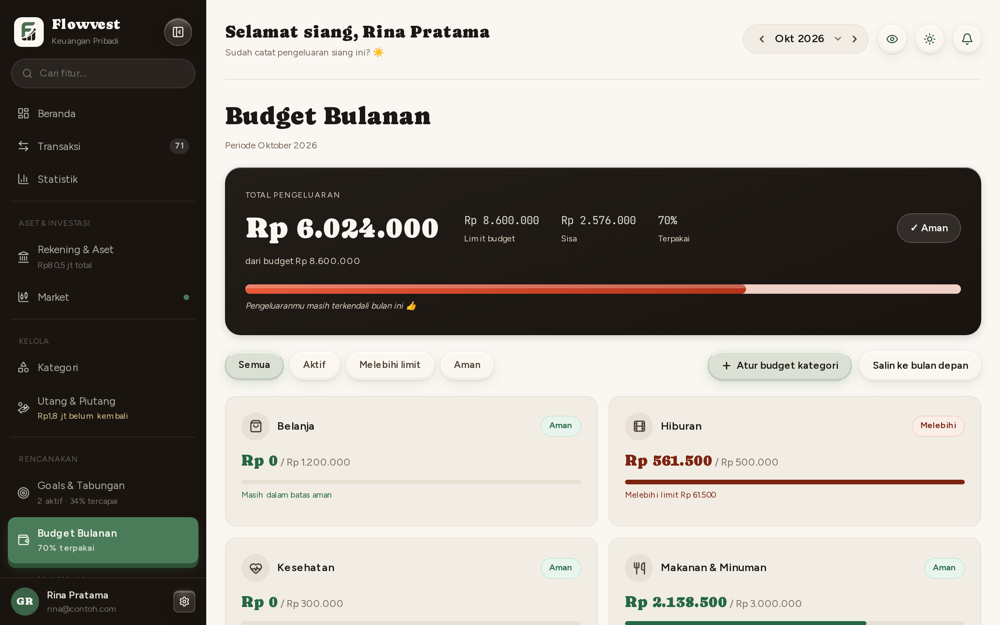
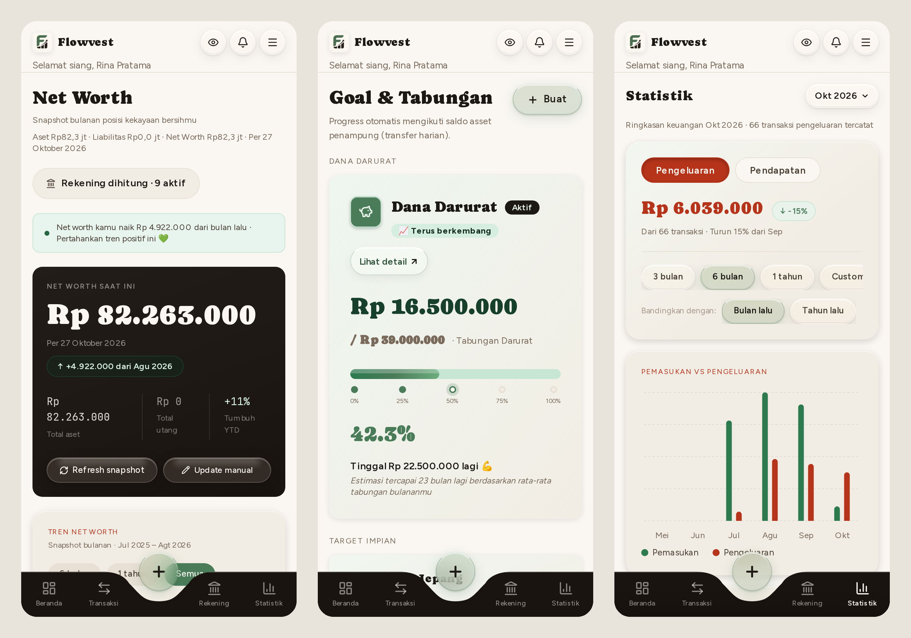

Flowvest is an Indonesian-language personal finance app for many users. One place to record income, expenses, and transfers, keep an eye on budgets, and then see the bigger picture: every account balance, net worth, savings goals, and a long-term life plan.

## What I built

The app has eleven areas: a home view with balances and financial health, transactions, cash-flow statistics, accounts and assets, Indonesian stock tracking with a watchlist, net worth, monthly budgets per category, savings goals, debts and receivables with payment proofs, categories, and a life roadmap.

Users sign in with email or a Google account. Sensitive numbers can be blurred with privacy mode, there is a dark mode, and the layout moves from a sidebar on desktop to bottom navigation on phones.

Every image on this page uses sample data from a local environment, not real financial data.

## Technical decisions

Data is fetched in Server Components and handed to client components that only deal with interaction. Every change goes through a Server Action that refreshes the affected pages when it is done.

Security lives in the database, not only in application code. Every user data table in PostgreSQL is protected by Row Level Security, so a person can only read and change their own rows even if a query is written wrong. Payment proofs are stored in a private bucket.

Stock market data comes from a public source with no service guarantee, so results are cached for an hour to keep pages fast and stay under rate limits.

## In progress

A Telegram bot for recording transactions in plain chat, such as "kopi 18rb" (coffee, 18k rupiah). Messages are parsed by a local parser first; an AI model is only an extra layer, with validated output and protection against instructions slipped into a message. This feature is not released yet.

## Try it

Flowvest is free and ready to use: [sign up with email or a Google account](https://flowvest.vercel.app/register). The app is in Indonesian. Feedback is very welcome, send it through the contact section below.
