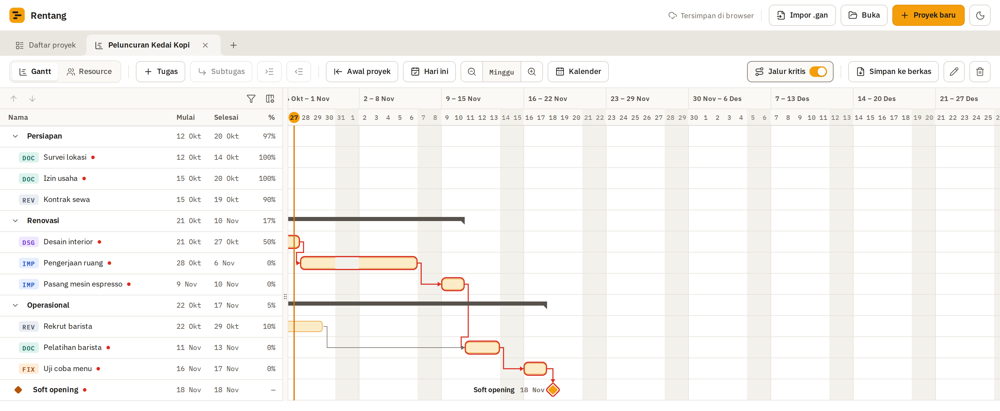
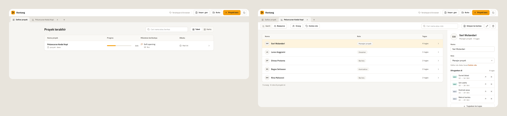

Rentang is a single-page web app for tracking tasks and project schedules. I built it to help manage my day-to-day work at the office: which tasks are running, which tasks are waiting on others, and roughly when a milestone will be reached.

The reason is simple. The Gantt app I used before is simple, and that is its strength, but it cannot write documents. The writing app I like, because it lets me write like an `.md` file, is not that simple for Gantt. So I plan to combine the two in one place, based on what my work needs, with the Gantt as the core and simplicity as the yardstick.

No office data appears on this page. Every image uses a fictional demo project ("Coffee Shop Launch"). The app itself is in Indonesian.

## What was built

Rentang opens Gantt files in the `.gan` format or its own `.rentang` files, then shows an import report explaining what was imported, changed, or skipped. Tasks appear nested in a table and a Gantt chart, with milestones and dependency arrows. Gantt bars can be dragged to move the schedule or change a duration, every edit can be undone, and the time scale has six levels from daily to yearly.

The critical path can be switched on to see which tasks push a milestone back directly if they slip. Working days and holidays are set in a calendar, so durations are counted in working days.

Several projects can be open at once in tabs. The project list shows each project's progress and next milestone, and the Resource view manages people, roles, and assigned tasks.

## Technical decisions

The code has three layers with dependencies running one way: interface, app, then core. Lint enforces that rule, so the build fails if it is broken. The core is plain TypeScript with no Svelte or DOM, so schedule logic can be tested in Node with a 90% coverage floor.

Dates are stored as `YYYY-MM-DD` text and never as `Date` objects, so time zone bugs cannot happen. End dates and the critical path are computed from the schedule by pure functions and not stored, so they cannot drift out of sync with the data. Undo and redo are built from Immer patches.

The app runs entirely in the browser and keeps projects in the browser, with no server and no account. Besides unit tests with Vitest, there are main-flow tests with Playwright, automated accessibility checks with axe, and a render-time test for 200 tasks.

## Not built yet

Two parts are still to come: editing task dependencies and project documents, meaning writing like a Markdown file next to the Gantt. Documents are the part that joins the two needs above. After that stage, my own development stops, but the project stays open for contributions.

## Open for contributions

Rentang is an open source project under the MIT license, and the code is on GitHub: [galihroswandi/Rentang](https://github.com/galihroswandi/Rentang). If you want to contribute, feel free to open an issue with a suggestion or a bug report, or send a pull request. As the owner, I am open to contributions and will review every pull request that comes in.
