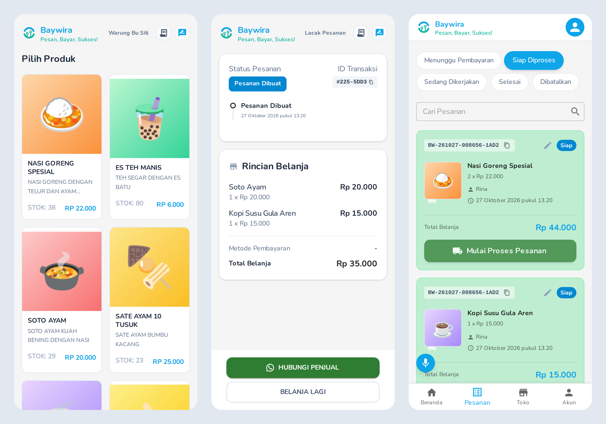
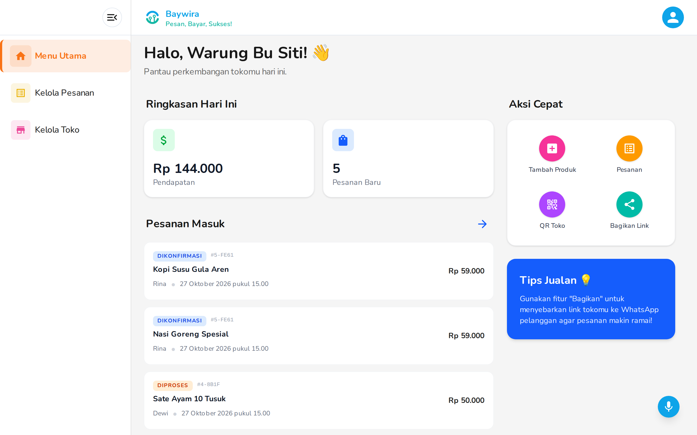

Baywira adalah platform untuk pedagang UMKM Indonesia. Penjual membuka toko, mengisi produk, lalu membagikan link atau QR code. Pelanggan memindai QR itu, memilih produk, dan memesan tanpa membuat akun. Pesanan bisa dilacak lewat ID transaksi, dan penjual mengelolanya dari dasbor.

Saya mengerjakannya sendiri dalam dua repo: klien Next.js (sekitar 80 commit) dan API NestJS (sekitar 260 commit sejak Juli 2024).

## Apa yang dibangun

Sisi pelanggan: etalase produk, keranjang dan formulir pesanan, pembayaran digital, lalu halaman pelacakan status dari pesanan dibuat sampai selesai. Tombol "Hubungi penjual" membuka WhatsApp.

Sisi penjual: ringkasan hari ini, daftar pesanan per status, produk dengan beberapa pilihan harga, pengaturan metode pembayaran, dan QR toko.

Semua gambar di halaman ini memakai data contoh di lingkungan lokal, bukan data penjual sebenarnya.

## Keputusan teknis

Aplikasinya PWA yang dipakai di ponsel. Permintaan tulis yang gagal karena offline masuk ke antrean di IndexedDB lalu dikirim ulang saat koneksi kembali. Permintaan berisi file tidak diantrekan karena tidak bisa disimpan di IndexedDB, jadi pengguna diberi tahu.

Stok dikurangi saat pesanan dibuat dan dikembalikan kalau pesanan dibatalkan. Pesanan yang belum dibayar kedaluwarsa lewat cron job per jam yang memeriksa token pembayaran di Redis, sehingga stok tidak tertahan oleh pesanan yang ditinggalkan.

Pemesanan tanpa akun dijaga dengan hCaptcha dan rate limiter. Kunci pembayaran penjual disimpan terenkripsi (AES-256), dan status pembayaran serta keranjang diperbarui lewat WebSocket.

Untuk penjual yang sedang sibuk berjualan, ada perintah suara untuk berpindah halaman, pengisian formulir produk dengan ucapan (misalnya "nasi goreng spesial dua puluh ribu stok lima puluh"), dan geser kartu pesanan untuk mengubah statusnya.
